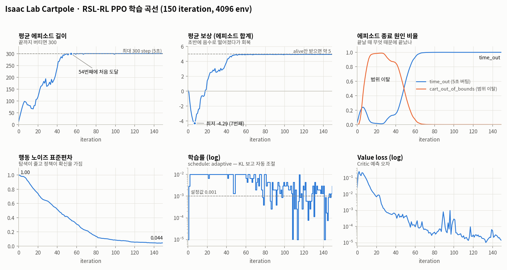

# Day 3 — Isaac Lab Cartpole로 RSL-RL PPO 돌려보기

> 학습 날짜: 2026-10-11
> 과제: `Isaac-Cartpole-v0` (manager-based)
> 환경: Ubuntu 24.04 / RTX 5070 Ti / Isaac Sim 5.1 / Isaac Lab / RSL-RL 3.1.2
> 로그: `~/IsaacLab/logs/rsl_rl/cartpole/2026-10-11_14-17-25/`

**한 줄 요약**: 4096개 Cartpole을 GPU에서 동시에 돌려 **약 19초 만에** 학습을 끝냈고,
54번째 iteration부터 모든 환경이 5초를 끝까지 버텼다. 2일차에 직접 짠 PPO와
RSL-RL PPO를 코드 단위로 비교했다.



---

## 1. 2일차 CartPole과 뭐가 다른가

2일차 8·9강에서도 CartPole을 썼지만, **다른 환경, 다른 PPO 구현**이다.

| | Day 2 (8·9강) | Day 3 |
|---|---|---|
| 환경 | Gymnasium `CartPole-v1` | Isaac Lab `Isaac-Cartpole-v0` (Isaac Sim 물리) |
| PPO | 직접 구현한 `my_ppo.py` | RSL-RL `OnPolicyRunner` |
| 행동 | 이산 (왼쪽/오른쪽), Categorical 분포 | 연속 (카트에 주는 힘), Gaussian 분포 |
| 병렬 환경 수 | 1개 | 4096개 |
| 실패 조건 | 막대가 ±12° 넘게 기울거나 카트 이탈 | **카트 이탈만** (막대가 넘어져도 안 끝남) |
| 보상 | 매 스텝 +1, 최대 500점 | 5개 항목의 합, 최대 약 5점 |
| 학습량 | 100,000 step (48 update) | 150 iteration × 16 step × 4096 env ≈ 980만 step |
| 실행 | macOS / CPU | Ubuntu / GPU |

---

## 2. 과제 정의 (`cartpole_env_cfg.py`)

파일: `~/IsaacLab/source/isaaclab_tasks/isaaclab_tasks/manager_based/classic/cartpole/cartpole_env_cfg.py`

Isaac Lab의 manager-based 환경은 MDP를 **관측 / 행동 / 이벤트 / 보상 / 종료** 설정 클래스로 나눠 적는다.

### 관측 (4개)

| 항목 | 내용 |
|---|---|
| `joint_pos_rel` | 카트 위치, 막대 각도 (기본 자세 대비) |
| `joint_vel_rel` | 카트 속도, 막대 각속도 |

→ Gymnasium CartPole과 똑같이 숫자 4개.

### 행동 (1개)

```python
joint_effort = mdp.JointEffortActionCfg(asset_name="robot", joint_names=["slider_to_cart"], scale=100.0)
```

- 신경망 출력 1개 × 100 = 카트 레일 관절에 주는 힘(effort)
- 연속값이라 정책은 평균(μ)과 표준편차(σ)를 가진 **Gaussian 분포**에서 행동을 뽑는다

### 리셋할 때 랜덤으로 흔들기 (`EventCfg`)

| 대상 | 위치 범위 | 속도 범위 |
|---|---|---|
| 카트 | ±1.0 m | ±0.5 m/s |
| 막대 | ±0.25π rad (±45°) | ±0.25π rad/s |

매번 다른 자세에서 시작하므로 한 가지 상황만 외우지 못한다.

### 보상 (`RewardsCfg`)

| 이름 | 가중치 | 뜻 | 코드 주석 |
|---|---|---|---|
| `alive` | +1.0 | 살아 있으면 상 | Constant running reward |
| `terminating` | −2.0 | 실패로 끝나면 벌점 | Failure penalty |
| `pole_pos` | −1.0 | 막대가 수직(0)에서 벗어나면 벌점 (L2) | **Primary task** |
| `cart_vel` | −0.01 | 카트가 빨리 움직이면 벌점 (L1) | Shaping task |
| `pole_vel` | −0.005 | 막대가 빨리 흔들리면 벌점 (L1) | Shaping task |

- Isaac Lab은 보상에 `dt`를 곱해서 더한다 → `alive`만 5초 받으면 약 **5점**이 최대
- 코드 주석이 `pole_pos`를 **주 과제(primary task)**라고 부른다. 막대가 넘어져도 에피소드가 안 끝나니,
  막대를 세우게 만드는 건 이 벌점이다.

### 종료 (`TerminationsCfg`)

| 이름 | 조건 |
|---|---|
| `time_out` | 5초 경과 (성공) |
| `cart_out_of_bounds` | 카트가 ±3.0 m 밖으로 나감 (실패 → `terminating` 벌점) |

### 시뮬레이션

- `sim.dt = 1/120`, `decimation = 2` → 정책은 1초에 60번 행동
- `episode_length_s = 5` → 최대 **300 step**

→ G1 보상 구조와 비교: [day4 G1 보상 구조 분석](../day4-g1-reward-baseline/g1_reward_structure.md)

---

## 3. 학습 설정 (`params/agent.yaml`)

| 설정 | RSL-RL (Day 3) | `my_ppo.py` (Day 2) |
|---|---|---|
| 한 번에 모으는 경험 | `num_steps_per_env=16` × 4096 env = 65,536 | `n_steps=2048` × 1 env |
| 미니배치 | `num_mini_batches=4` (→ 16,384개씩) | `batch_size=64` |
| epoch | `num_learning_epochs=5` | `n_epochs=10` |
| 학습률 | `0.001`, **`schedule: adaptive`** | `3e-4` 고정 |
| clip | `clip_param=0.2` | `clip_range=0.1` |
| `gamma` / `lam` | 0.99 / 0.95 | 0.99 / 0.95 |
| value loss 계수 | `value_loss_coef=1.0` | `vf_coef=0.5` |
| entropy 계수 | `entropy_coef=0.005` | `ent_coef=0.0` |
| gradient clip | `max_grad_norm=1.0` | `max_grad_norm=0.5` |
| 신경망 | Actor/Critic 각각 [32, 32], ELU | |
| 초기 행동 노이즈 | `init_noise_std=1.0` | (이산 행동이라 없음) |

---

## 4. 학습 결과 (TensorBoard 로그)

| iteration | 평균 에피소드 길이 | 평균 보상 |
|---:|---:|---:|
| 0 | 12.8 | 0.13 |
| 7 | — | **−4.29 (최저)** |
| 10 | 83.4 | −2.98 |
| 20 | 117.2 | 1.40 |
| 30 | 163.6 | 2.57 |
| 40 | 242.5 | 3.93 |
| 50 | 299.5 | 4.91 |
| 100 | 300.0 | 4.94 |
| 149 | 300.0 | 4.93 |

그래프에서 보이는 것:

- **에피소드 길이**: 54번째 iteration에 처음으로 300 (= 끝까지 버팀) 도달
- **평균 보상**: 7번째에 −4.29까지 떨어졌다가 회복. 최종 4.93으로 최대치(약 5)에 거의 붙음
- **종료 원인**: 10~40번째에는 거의 다 `cart_out_of_bounds`로 끝남 → 50번째 근처에서 역전 → 70번째 이후 100% `time_out`
- **행동 노이즈 σ**: 1.0 → 0.044
- **학습률**: 설정값은 0.001인데 실제로는 1e-5 ~ 1e-2 사이를 계속 오르내림 (5장 참고)
- **Value loss**: 약 0.1 → 1e-5 수준으로 감소
- 전체 학습 시간 약 **19초** (초당 약 54만 step)

그래프 다시 그리기:

```bash
~/miniforge3/envs/isaaclab/bin/python day3-isaaclab-cartpole/plot_training_curves.py \
    ~/IsaacLab/logs/rsl_rl/cartpole/2026-10-11_14-17-25 \
    day3-isaaclab-cartpole/images/training_curves.png
```

---

## 5. RSL-RL PPO 코드 vs 내가 짠 `my_ppo.py`

RSL-RL 소스: `~/miniforge3/envs/isaaclab/lib/python3.11/site-packages/rsl_rl/` (v3.1.2)

PPO의 뼈대는 같다. 1·2일차에 배운 개념이 RSL-RL 코드에서 어디에 있는지 찾아봤다.

### 5.1 GAE — 거의 똑같다

RSL-RL (`storage/rollout_storage.py`):

```python
delta = self.rewards[step] + next_is_not_terminal * gamma * next_values - self.values[step]
advantage = delta + next_is_not_terminal * gamma * lam * advantage
self.returns[step] = advantage + self.values[step]
```

my_ppo.py:

```python
delta = self.rewards[t] + gamma * next_value * next_non_terminal - self.values[t]
last_gae = delta + gamma * gae_lambda * next_non_terminal * last_gae
self.returns = self.advantages + self.values
```

→ [2일차 4·5강](../day2-ppo/PPO_04-05강_Advantage_GAE와_손실함수.md)에서 배운 `TD error → GAE → Return = Advantage + Value` 그대로.

### 5.2 Advantage 정규화 — 하는 시점이 다르다

| | 언제 정규화하나 |
|---|---|
| RSL-RL | rollout 전체(65,536개)를 **한 번에** (`normalize_advantage_per_mini_batch: false`) |
| my_ppo.py | **미니배치마다** (64개씩) |

### 5.3 Clipped Surrogate — 부호만 다르고 같은 식

RSL-RL (`algorithms/ppo.py`):

```python
surrogate = -torch.squeeze(advantages_batch) * ratio
surrogate_clipped = -torch.squeeze(advantages_batch) * torch.clamp(ratio, 1.0 - self.clip_param, 1.0 + self.clip_param)
surrogate_loss = torch.max(surrogate, surrogate_clipped).mean()
```

my_ppo.py:

```python
policy_loss_1 = advantages * ratio
policy_loss_2 = advantages * th.clamp(ratio, 1 - clip_range, 1 + clip_range)
policy_loss = -th.min(policy_loss_1, policy_loss_2).mean()
```

→ `max(−a, −b) = −min(a, b)`. 마이너스를 먼저 붙이냐 나중에 붙이냐 차이일 뿐 같은 값.

### 5.4 Value loss — RSL-RL은 여기에도 clipping

```python
value_clipped = target_values_batch + (value_batch - target_values_batch).clamp(-self.clip_param, self.clip_param)
value_losses = (value_batch - returns_batch).pow(2)
value_losses_clipped = (value_clipped - returns_batch).pow(2)
value_loss = torch.max(value_losses, value_losses_clipped).mean()
```

- my_ppo.py는 그냥 MSE (`F.mse_loss(returns, values_pred)`)
- RSL-RL은 Critic 예측도 이전 값에서 `clip_param`(0.2) 이상 못 움직이게 제한 (`use_clipped_value_loss: true`)

### 5.5 전체 loss — 같은 구조

```python
# RSL-RL
loss = surrogate_loss + self.value_loss_coef * value_loss - self.entropy_coef * entropy_batch.mean()
# my_ppo.py
loss = policy_loss + ent_coef * entropy_loss + vf_coef * value_loss   # entropy_loss = -entropy.mean()
```

### 5.6 Adaptive 학습률 — my_ppo.py에는 없는 것

```python
kl_mean = torch.mean(kl)          # 이전 정책과 현재 정책의 KL divergence (Gaussian 공식)
if kl_mean > self.desired_kl * 2.0:
    self.learning_rate = max(1e-5, self.learning_rate / 1.5)
elif kl_mean < self.desired_kl / 2.0 and kl_mean > 0.0:
    self.learning_rate = min(1e-2, self.learning_rate * 1.5)
```

| KL 상황 (`desired_kl=0.01`) | 학습률 |
|---|---|
| KL > 0.02 (정책이 너무 많이 변함) | ÷1.5, 최소 **1e-5** |
| KL < 0.005 (정책이 거의 안 변함) | ×1.5, 최대 **1e-2** |
| 그 사이 | 그대로 |

- **미니배치마다** 검사한다
- 학습률 그래프가 1e-2와 1e-5 사이에서 계단처럼 움직인 이유가 이것
- 9강에서는 `learning_rate`를 손으로 바꿔가며 실험했는데, RSL-RL은 KL을 보고 자동으로 조절한다
  ([2일차 6·7강](../day2-ppo/PPO_06-07강_Ratio_Clipping과_전체학습루프.md)의 "기존 정책과 현재 정책이 너무 달라지면 안 된다"를 clip 말고 학습률로도 막는 것)

---

## 6. 다시 실행하는 법

```bash
cd ~/IsaacLab

# 학습 (기본 설정)
./isaaclab.sh -p scripts/reinforcement_learning/rsl_rl/train.py --task Isaac-Cartpole-v0 --headless

# 학습된 정책 보기 (가장 최근 run의 마지막 checkpoint)
./isaaclab.sh -p scripts/reinforcement_learning/rsl_rl/play.py --task Isaac-Cartpole-v0 --num_envs 32

# TensorBoard
./isaaclab.sh -p -m tensorboard.main --logdir logs/rsl_rl/cartpole
```

설정은 명령줄 끝에 Hydra 형식으로 덮어쓸 수 있다 (`agent.` = agent.yaml, `env.` = env.yaml):

```bash
./isaaclab.sh -p scripts/reinforcement_learning/rsl_rl/train.py --task Isaac-Cartpole-v0 --headless \
    --run_name lr_fixed agent.algorithm.schedule=fixed
```

---

## 7. 아직 안 한 것

README에 적은 Day 3 목표는 **하이퍼파라미터 실험**인데, 지금은 기본 설정으로 1회만 학습했다.
9강 방식(예측 → 하나만 바꾸기 → 실행 → 기록 → 해석)으로 해볼 만한 후보:

| 실험 | 바꿀 것 | 왜 궁금한가 |
|---|---|---|
| 학습률 고정 | `agent.algorithm.schedule=fixed` | adaptive가 없으면 학습 속도가 어떻게 달라지나 |
| 환경 수 | `--num_envs 512` | 병렬 환경이 적으면 같은 iteration에서 결과가 어떻게 되나 |
| 주 과제 벌점 끄기 | `env.rewards.pole_pos.weight=0.0` | 막대가 넘어져도 안 끝나는데 이 벌점까지 없으면? (보상 해킹 연결) |

- [ ] 위 중 1~2개 실험하고 결과를 이 노트에 추가
- [ ] `play.py`로 실행 화면 캡처해서 `images/`에 넣기
