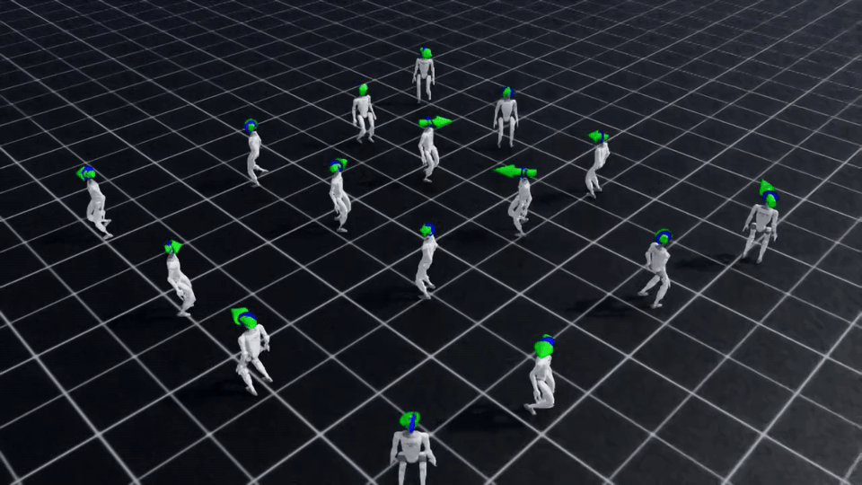

# Day 4 — G1 휴머노이드 평지 보행 기본 학습 (실험 0)

> 학습 날짜: 2026-10-11
> 이 실험은 Day 5 보상 실험의 **기준(baseline)**이다.



---

## 1. 과제와 환경

| 항목 | 값 |
|---|---|
| 과제 | `Isaac-Velocity-Flat-G1-v0` (Unitree G1, 평지에서 속도 명령 따라 걷기) |
| 속도 명령 범위 | 앞뒤 0.0 ~ 1.0 m/s, 좌우 −0.5 ~ 0.5 m/s, 회전 −1.0 ~ 1.0 rad/s |
| OS / GPU | Ubuntu 24.04 / NVIDIA RTX 5070 Ti |
| 시뮬레이터 | Isaac Sim 5.1, Isaac Lab 2.3.2 |
| 알고리즘 | RSL-RL PPO |
| 병렬 환경 수 | 4096 |
| 학습량 | 1500 iteration × 24 step × 4096 env ≈ 1.5억 step |
| 학습 시간 | 약 27분 (TensorBoard 로그 기준 27.3분) |
| seed | 42 |
| 에피소드 길이 | 최대 20초 = 1000 step (`dt=0.005`, `decimation=4` → 정책 50 Hz) |

학습 명령어:

```bash
cd ~/IsaacLab
./isaaclab.sh -p scripts/reinforcement_learning/rsl_rl/train.py --task Isaac-Velocity-Flat-G1-v0 --headless
```

로그: `~/IsaacLab/logs/rsl_rl/g1_flat/2026-10-11_18-36-30/`

---

## 2. 보상 구조 요약

자세한 설명: [1교시 노트 — G1은 무엇으로 점수를 받을까?](lesson01_g1_reward_structure.md)

| 그룹 | 역할 | 항목 (가중치) |
|---|---|---|
| ① 명령대로 걸어라 (+) | **무엇을** 할지 | `track_lin_vel_xy_exp` (1.0), `track_ang_vel_z_exp` (1.0), `feet_air_time` (0.75) |
| ② 얌전하게 움직여라 (−) | **어떻게** 할지 | `action_rate_l2` (−0.005), `dof_torques_l2` (−2e-6), `dof_acc_l2` (−1e-7), `feet_slide` (−0.1) |
| ③ 자세 바르게 해라 (−) | **어떻게** 할지 | `flat_orientation_l2` (−1.0), `joint_deviation_*` (−0.05 ~ −0.1), `lin_vel_z_l2` (−0.2), `ang_vel_xy_l2` (−0.05), `dof_pos_limits` (−1.0), `termination_penalty` (−200) |

- 가중치는 실험 0의 `params/env.yaml`에서 확인했다.
- 상점만 있으면 떨거나 이상한 자세로 걷고, 벌점만 있으면 가만히 서 있거나 일부러 넘어지는 **보상 해킹**이 생길 수 있다.
  그래서 두 종류가 함께 필요하다.

---

## 3. 학습 결과

### 학습 진행

| 시점 | 내용 |
|---|---|
| 50~100번째 iteration | 모든 환경이 넘어져서 끝남 (`base_contact` 100%) |
| 125번째 iteration | 평균 보상 최저 (−10.67). 이때 가장 큰 벌점은 `action_rate_l2` (−0.40) |
| 131번째 iteration | 평균 에피소드 길이가 처음 990 step 이상 (거의 20초를 버팀) |
| 170번째 iteration | 평균 보상이 다시 양수 (0.28), 넘어짐 3.4% |
| 1499번째 (마지막) | 평균 보상 27.86 |

학습 곡선(실험 1과 겹쳐 그림): [day5 학습 곡선](../day5-g1-reward-experiment/images/learning_curves_exp0_vs_exp1.png)

### 마지막 지표

| 지표 | 마지막 값 | 마지막 100회 평균 ± 표준편차 |
|---|---:|---:|
| mean reward | 27.86 | 27.78 ± 0.21 |
| mean episode length (step, 최대 1000) | 995.2 | 996.6 ± 5.1 |
| 종료: `base_contact` (넘어짐 비율) | 0.51% | 0.41% ± 0.06% |
| 종료: `time_out` (20초 버팀 비율) | 99.49% | 99.59% ± 0.06% |
| 속도 명령 오차 xy | 0.2065 | 0.2152 ± 0.0042 |
| `track_lin_vel_xy_exp` | 0.9382 | 0.9359 ± 0.0098 |
| `track_ang_vel_z_exp` | 0.7651 | 0.7640 ± 0.0079 |
| `feet_air_time` | 0.0501 | 0.0494 ± 0.0013 |
| `feet_slide` | −0.0122 | −0.0123 ± 0.0002 |
| `action_rate_l2` | −0.1664 | −0.1678 ± 0.0017 |
| `dof_torques_l2` | −0.0065 | −0.0065 ± 0.0001 |

- `Episode_Reward/*` 값은 가중치를 곱한 보상의 에피소드 합 평균을 최대 에피소드 길이(20초)로 나눈 값이다.
- 전체 지표: [metrics_table.md](../day5-g1-reward-experiment/metrics_table.md)

### 관찰

- 마지막 100 iteration 동안 99.6%의 환경이 20초를 끝까지 버텼다 (넘어짐 0.4%).
- 상점 중에서는 이동 명령 추종(`track_lin_vel_xy_exp`, 0.94)이 가장 크고,
  벌점 중에서는 `action_rate_l2`(−0.17)가 가장 크다.
- 에피소드 길이가 1000에 붙은 뒤(131번째 이후)에도 지표는 계속 좋아졌다.

  | iteration | `track_lin_vel_xy_exp` | `track_ang_vel_z_exp` | `action_rate_l2` | mean reward |
  |---:|---:|---:|---:|---:|
  | 131 | 0.42 | 0.09 | −0.43 | −9.50 |
  | 300 | 0.90 | 0.48 | −0.22 | 19.12 |
  | 500 | 0.93 | 0.71 | −0.19 | 25.62 |
  | 1499 | 0.94 | 0.77 | −0.17 | 27.86 |

  → **먼저 넘어지지 않는 법**을 배우고, 그다음 **명령 추종과 부드러운 움직임**을 다듬는 순서로 학습됐다.
