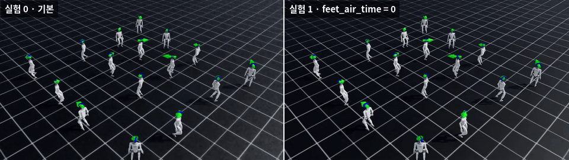
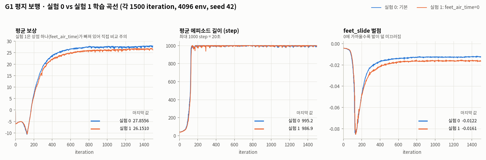

# Day 5 — 보상 실험 1: `feet_air_time` 끄기

> 실험 날짜: 2026-10-11
> 기준 실험(실험 0): [Day 4 노트](../day4-g1-reward-baseline/notes.md)



---

## 1. 가설

`feet_air_time`은 발을 공중에 적당히 들었다 놓을 때 주는 상점이므로, 0으로 끄면 발을 들 이유가 사라져
**보폭이 줄고 발을 끄는 걸음**이 나올 것이다.

참고 — `feet_air_time`의 실제 정의 (`feet_air_time_positive_biped`):
- **한 발로만 서 있는 동안**(single stance) 그 상태가 지속된 시간을 상점으로 준다 (최대 0.4초에서 잘림)
- 속도 명령이 거의 0이면(0.1 m/s 이하) 상점이 없다

---

## 2. 바꾼 것 — 딱 하나

```bash
cd ~/IsaacLab
./isaaclab.sh -p scripts/reinforcement_learning/rsl_rl/train.py --task Isaac-Velocity-Flat-G1-v0 --headless \
    --run_name no_feet_air_time env.rewards.feet_air_time.weight=0.0
```

두 실험의 저장된 설정 파일(`params/env.yaml`, `params/agent.yaml`)을 `diff`로 비교해 확인했다.

- 근거: 실험 1의 `params/env.yaml`에서 `rewards` → `feet_air_time` 항목의 **weight 0.0 확인** (실험 0은 같은 자리가 0.75)
- 두 파일의 차이는 이 가중치 한 줄과 로그 경로·`run_name`뿐이었다.

| 설정 | 실험 0 | 실험 1 |
|---|---|---|
| `rewards.feet_air_time.weight` | 0.75 | **0.0** |
| `run_name` | (없음) | `no_feet_air_time` |
| 그 외 (seed 42, 4096 env, 1500 iteration, 나머지 보상 가중치 등) | 같음 | 같음 |

로그: `~/IsaacLab/logs/rsl_rl/g1_flat/2026-10-11_20-25-28_no_feet_air_time/` (학습 시간 27.0분)

---

## 3. 결과

### 비교표 (주요 지표)

마지막 100 iteration의 평균 ± 표준편차. "크기 변화"는 절댓값 기준이며, 벌점 항목에서 **+는 벌점이 커졌다**는 뜻이다.

| 지표 | 실험 0 (기본) | 실험 1 (feet_air_time=0) | 크기 변화 |
|---|---:|---:|---:|
| mean reward | 27.78 ± 0.21 | 26.57 ± 0.19 | −4% |
| mean episode length (step, 최대 1000) | 996.6 ± 5.1 | 997.5 ± 4.0 | +0% |
| 종료: `base_contact` (넘어짐 비율) | 0.41% ± 0.06% | 0.39% ± 0.09% | −6% |
| 종료: `time_out` (20초 버팀 비율) | 99.59% | 99.61% | +0% |
| 속도 명령 오차 xy | 0.2152 ± 0.0042 | 0.2238 ± 0.0049 | +4% |
| `track_lin_vel_xy_exp` | 0.9359 ± 0.0098 | 0.9341 ± 0.0056 | −0% |
| `track_ang_vel_z_exp` | 0.7640 ± 0.0079 | 0.7651 ± 0.0039 | +0% |
| `feet_air_time` | 0.0494 ± 0.0013 | 0 (가중치 0) | — |
| **`feet_slide`** (발 미끄러짐 벌점) | −0.0123 ± 0.0002 | −0.0162 ± 0.0003 | **+32%** (벌점이 커짐 = 더 미끄러짐) |
| `action_rate_l2` | −0.1678 ± 0.0017 | −0.1711 ± 0.0008 | +2% |
| `dof_torques_l2` | −0.0065 ± 0.0001 | −0.0078 ± 0.0001 | +20% |
| `flat_orientation_l2` | −0.0077 ± 0.0006 | −0.0098 ± 0.0007 | +28% |
| `dof_pos_limits` | −0.0025 ± 0.0002 | −0.0035 ± 0.0003 | +44% |
| `joint_deviation_hip` | −0.0227 ± 0.0008 | −0.0253 ± 0.0006 | +11% |
| `dof_acc_l2` | −0.0114 ± 0.0002 | −0.0100 ± 0.0002 | −12% |
| `ang_vel_xy_l2` | −0.0122 ± 0.0002 | −0.0112 ± 0.0002 | −8% |
| `joint_deviation_torso` | −0.0060 ± 0.0002 | −0.0053 ± 0.0002 | −12% |

- 마지막 값 기준 비교와 전체 지표: [metrics_table.md](metrics_table.md)
- 다시 뽑기: `~/miniforge3/envs/isaaclab/bin/python day5-g1-reward-experiment/extract_metrics.py` ([스크립트](extract_metrics.py))

### 학습 곡선



---

## 4. 해석

### `feet_slide` → 가설을 지지한다

- `feet_slide`는 **땅에 닿아 있는 발의 수평 속도**에 주는 벌점이라 값이 음수다.
  실험 0은 −0.0123, 실험 1은 −0.0162로, **발 미끄러짐 벌점의 크기가 32% 커졌다. 즉 실험 1에서 발이 더 미끄러졌다.**
- 두 실험의 가중치(−0.1)가 같으므로 가중치로 나누면 원래 값이 나온다.
  땅에 닿은 두 발의 수평 속도 합(시간 평균)이 약 0.123 → 0.162 m/s로 늘었다.
  (Isaac Lab은 매 step `값 × 가중치 × dt`를 더해 20초로 나눠 기록하고, 거의 모든 에피소드가 20초를 채웠으므로 시간 평균으로 볼 수 있다.)
- 차이(0.0039)는 각 실험의 마지막 100회 표준편차(0.0002~0.0003)보다 10배 이상 크다.
- 학습 중에도 250번째 iteration 무렵부터 벌어지기 시작해, 300번째 이후로는 실험 1이 계속 1.24~1.33배 컸다 (50 iteration 구간 평균).
- → "발을 끄는 걸음이 나올 것이다"와 **같은 방향**의 결과다.

### `action_rate_l2` → 판단하기 어렵다

- +2% (−0.1678 → −0.1711). 차이가 작고, 학습 중반 1.04~1.06배에서 마지막엔 1.01~1.02배로 줄었다.
- 가설과 직접 연결되는 지표도 아니어서, 이 실험만으로 의미 있는 변화라고 말하기 어렵다.

### `base_contact` → 차이 없음

- 넘어짐 비율 0.41% → 0.39%로 사실상 같다. 에피소드 길이와 `time_out` 비율도 같다.
- `feet_air_time` 상점이 없어도 **넘어지지 않고 명령을 따라 걷는 정책**은 학습됐다.
  (가설은 넘어짐을 예측하지 않았으므로, 이 결과는 가설을 지지하지도 반박하지도 않는다.)

### "보폭이 줄 것이다" → 숫자로는 판단할 수 없다

- 로그에 보폭이나 발 체공 시간을 직접 재는 지표가 없다.
- 실험 1의 `Episode_Reward/feet_air_time`은 가중치가 0이라 걸음과 상관없이 항상 0으로 기록된다.
- 비교 GIF는 해상도가 작아서 보폭 차이를 눈으로 판단하기도 어렵다.

### 그 밖의 변화 (참고)

- 명령 추종은 거의 같다 (`track_lin_vel_xy_exp` 0.936 → 0.934, `track_ang_vel_z_exp` 0.764 → 0.765).
  속도 명령 오차 xy는 4% 늘었다 (0.2152 → 0.2238).
- 커진 벌점: `dof_torques_l2` +20%, `flat_orientation_l2` +28%, `dof_pos_limits` +44%, `joint_deviation_hip` +11%.
  작아진 벌점: `dof_acc_l2` −12%, `ang_vel_xy_l2` −8%, `joint_deviation_torso` −12%.
  방향이 섞여 있어서, 왜 이렇게 바뀌었는지는 이 데이터로 설명하기 어렵다.

### 평균 보상이 줄어든 건 "성능이 나빠졌다"는 뜻이 아니다

- 평균 보상은 27.78 → 26.57로 1.21 줄었다.
- 그런데 실험 0이 `feet_air_time`으로 받던 상점이 에피소드당 약 0.99 (0.0494 × 20초)다.
  → 차이의 대부분은 **빠진 상점 그 자체**다.
- 보상 함수가 다른 두 실험을 **총 보상으로 비교하면 안 된다.** 개별 지표(넘어짐, 명령 추종, 벌점)로 비교해야 한다.

### 이 해석의 한계

- **각 조건을 시드 1개로 한 번씩만 학습했기 때문에 이 차이가 잡음일 수 있다. 시드를 바꿔 반복하면 더 확실하게 판단할 수 있다.**
- 위에서 비교한 표준편차는 한 번의 학습 안에서 iteration 사이의 흔들림이고, 시드를 바꿨을 때의 차이는 아니다.
  그래서 `feet_slide` 차이가 표준편차의 10배 이상이어도, 시드 사이의 차이보다 큰지는 아직 모른다.
- 보폭과 체공 시간은 직접 재지 않았다.

---

## 5. 결론

1. `feet_air_time`을 끄자 발 미끄러짐 벌점이 −0.0123 → −0.0162로 크기가 32% 커졌다. 즉 실험 1에서 발이 더 미끄러졌다 → "발을 끄는 걸음" 가설과 같은 방향.
2. 넘어짐 비율과 명령 추종은 거의 그대로였다 → 이 상점은 "걸을 수 있느냐"보다는 **걸음의 질**에 영향을 주는 것으로 보인다.
3. 보폭이 줄었는지는 이 로그로 판단할 수 없다.
4. 시드 1개 결과라서 위 결론은 시드 3개 반복으로 확인해야 한다.

## 6. 다음에 할 것

- [ ] 실험 0·1을 시드 3개씩 반복해 차이가 유지되는지 확인
- [ ] `play.py` 실행 중 발 체공 시간과 보폭을 직접 기록 (접촉 센서의 `current_air_time`, `last_air_time`)
- [ ] 한 로봇을 가까이서 찍은 영상으로 걸음 비교
